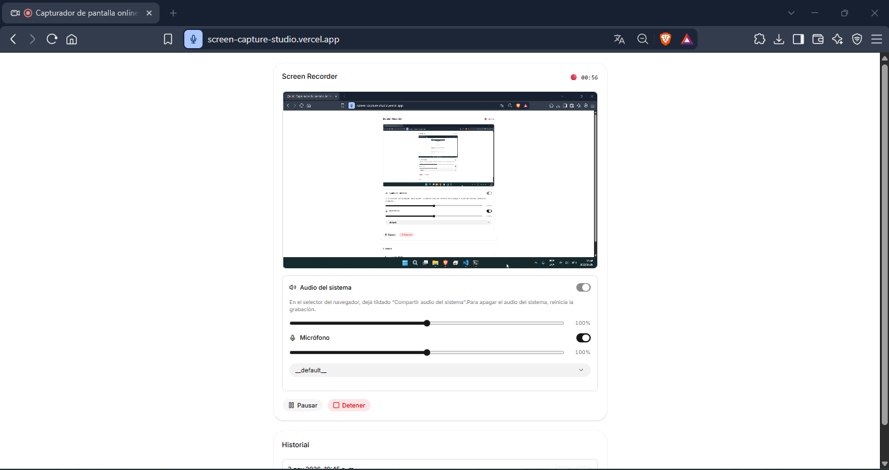

# Screen Capture Studio

Aplicación web para grabar la pantalla y capturar el audio del sistema y del micrófono directamente desde el navegador. Permite controlar la grabación, ajustar los niveles de audio y almacenar los archivos localmente, sin necesidad de un backend ni de subir información a servidores externos.

**Demo:** [Screen Capture Studio](https://screen-capture-studio.vercel.app/)

**Captura de la aplicación:**



## Funcionalidades

- **Captura de pantalla:** permite seleccionar una pantalla completa, ventana o pestaña desde el selector nativo del navegador.
- **Control de grabación:** iniciar, pausar, reanudar y detener la grabación, con un temporizador que excluye los períodos de pausa.
- **Captura de audio:** permite grabar el audio del sistema y el micrófono de forma independiente o combinada.
- **Gestión del micrófono:** selección del dispositivo de entrada, activación y desactivación durante la grabación y detección de errores de permisos o dispositivos desconectados.
- **Control de volumen:** ajuste independiente del volumen del micrófono y del audio del sistema, con un rango de 0 % a 200 %.
- **Exportación de grabaciones:** generación de archivos MP4 o WebM, según la compatibilidad del navegador, con corrección de metadatos para facilitar su reproducción y navegación.
- **Historial persistente:** almacenamiento automático de las grabaciones en IndexedDB, con opciones para reproducir, descargar y eliminar archivos.
- **Vista previa unificada:** visualización de la pantalla compartida durante la captura y reproducción de la grabación una vez finalizada.

## Tecnologías utilizadas

| Tecnología | Uso |
|---|---|
| React | Desarrollo de la interfaz mediante componentes. |
| TypeScript | Tipado estático y seguridad en el desarrollo. |
| Vite | Entorno de desarrollo y construcción del proyecto. |
| Tailwind CSS | Estilización de la interfaz. |
| shadcn/ui | Componentes reutilizables de interfaz. |
| Lucide React | Iconografía. |
| Screen Capture API | Captura de pantalla y audio del sistema. |
| MediaDevices API | Acceso al micrófono. |
| Web Audio API | Mezcla de fuentes de audio y control de volumen. |
| MediaRecorder API | Grabación de audio y video. |
| IndexedDB + idb | Almacenamiento local de las grabaciones. |
| mediabunny | Reempaquetado de archivos MP4. |
| webm-duration-fix | Corrección de la duración de archivos WebM. |
| Vitest + Testing Library | Pruebas automatizadas. |

## Decisiones técnicas

**Separación de responsabilidades.** La lógica de captura, procesamiento de audio, grabación, descarga y almacenamiento se encuentra desacoplada de la interfaz. Los servicios de `services/` implementan las operaciones principales, mientras que los hooks de `hooks/` gestionan su integración con el estado de React.

**Mezcla de audio mediante Web Audio API.** Cada fuente de audio utiliza su propio `GainNode` para controlar el volumen de manera independiente. Posteriormente, ambas fuentes se combinan mediante un `MediaStreamDestination`. La pista de audio permanece disponible durante toda la grabación, incluso cuando el micrófono está desactivado, permitiendo modificar su estado sin reiniciar la captura. Los cambios de volumen utilizan `setTargetAtTime` para evitar variaciones bruscas.

**Selección dinámica del formato.** Se utiliza `MediaRecorder.isTypeSupported()` para determinar el formato más adecuado entre los disponibles. Se prioriza MP4 con H.264 cuando existe compatibilidad y se utiliza WebM con VP9 o VP8 y Opus como alternativa.

**Reempaquetado de archivos MP4.** Algunos navegadores generan archivos MP4 fragmentados, cuyos metadatos no permiten realizar correctamente operaciones de navegación temporal en determinados reproductores. Para solucionar este inconveniente, se utiliza `mediabunny` para reempaquetar el archivo al finalizar la grabación, sin recodificar el contenido ni perder calidad. En el caso de WebM, se utiliza `webm-duration-fix` para corregir la duración.

**Prevención de condiciones de carrera.** Al iniciar una grabación, el flujo multimedia obtenido se entrega directamente al grabador, evitando depender de una actualización posterior del estado de React. Esto previene que la grabación comience con un flujo nulo o que ya haya sido cerrado.

**Persistencia local con IndexedDB.** Los archivos se almacenan como objetos `Blob` directamente en IndexedDB, una alternativa más adecuada que `localStorage` para gestionar archivos de gran tamaño. El almacenamiento es independiente del servidor de despliegue.

## Estructura del proyecto

```text
screen-capture-studio/
├── src/
│   ├── components/
│   │   ├── ui/              # Componentes de shadcn/ui
│   │   └── recorder/        # Interfaz del grabador
│   ├── hooks/               # Hooks para captura y grabación
│   ├── services/            # Captura, audio, almacenamiento y descarga
│   ├── types/               # Definiciones de tipos
│   ├── utils/               # Funciones auxiliares
│   ├── App.tsx
│   └── main.tsx
├── tests/                   # Pruebas automatizadas
├── docs/                    # Documentación y capturas
├── package.json
├── tsconfig.json
└── vite.config.ts
```

## Compatibilidad y limitaciones

La disponibilidad de las funcionalidades depende del navegador y del sistema operativo.

| Navegador | Pantalla | Micrófono | Audio del sistema | Formato |
|---|---|---|---|---|
| Chrome / Edge (Windows) | Sí | Sí | Según la fuente compartida | MP4, WebM |
| Chrome (macOS) | Sí | Sí | Principalmente pestañas | MP4, WebM |
| Firefox | Sí | Sí | Limitado | WebM |
| Safari | Sí | Sí | Limitado | MP4, WebM |

**Consideraciones:**

- Para capturar el audio del sistema, es necesario habilitar la opción correspondiente en el selector del navegador, cuando esté disponible.
- La captura de audio del sistema puede estar limitada al compartir pestañas o pantallas completas. No está garantizada al compartir ventanas.
- Se recomienda utilizar auriculares para evitar el eco al grabar simultáneamente el micrófono y el audio del sistema.
- La aplicación requiere un contexto seguro (HTTPS o `localhost`).
- Los formatos disponibles dependen de las capacidades de `MediaRecorder` del navegador.

## Privacidad y almacenamiento

La aplicación funciona íntegramente en el navegador, sin necesidad de un backend.

- Las grabaciones se almacenan localmente en IndexedDB.
- No se envían grabaciones a servidores externos.
- El historial es independiente para cada navegador, perfil y dominio.
- El almacenamiento no constituye un respaldo. Borrar los datos del sitio, utilizar el modo incógnito o quedarse sin espacio disponible puede provocar la pérdida de las grabaciones.

Se recomienda descargar los archivos que se deseen conservar.

## Instalación y ejecución

**Requisitos previos:**

- Node.js 20.19 o superior.
- npm.

**Clonar el repositorio e instalar las dependencias:**

```bash
git clone https://github.com/Fede-Code-007/screen-capture-studio.git
cd screen-capture-studio
npm install
```

**Iniciar el servidor de desarrollo:**

```bash
npm run dev
```

La aplicación estará disponible en `http://localhost:5173`.

## Scripts disponibles

| Comando | Descripción |
|---|---|
| `npm run dev` | Inicia el servidor de desarrollo. |
| `npm run build` | Verifica los tipos y genera el build de producción. |
| `npm run preview` | Ejecuta una vista previa del build de producción. |
| `npm run lint` | Ejecuta el análisis estático del código. |
| `npm test` | Ejecuta las pruebas en modo watch. |
| `npm run test:run` | Ejecuta todas las pruebas una sola vez. |

## Pruebas

El proyecto utiliza Vitest y Testing Library para verificar el comportamiento de sus principales componentes y servicios.

Las pruebas automatizadas cubren:

- Funciones auxiliares y formateo de datos.
- Lógica del temporizador de grabación.
- Servicio de descarga de archivos.
- Selección del formato multimedia compatible.

Las APIs multimedia del navegador, como `MediaRecorder`, `getDisplayMedia` y `AudioContext`, no están disponibles de forma nativa en el entorno jsdom. Por este motivo, el funcionamiento real de la captura y la grabación requiere pruebas manuales en un navegador compatible.

## Posibles mejoras

- Configuración avanzada de resolución, FPS y bitrate.
- Indicador visual de actividad del micrófono mediante `AnalyserNode`.
- Visualización del espacio de almacenamiento utilizado mediante `navigator.storage.estimate()`.
- Exportación directa a carpetas mediante File System Access API.
- Sincronización en la nube mediante un backend y autenticación.

## Licencia

Este proyecto forma parte de mi portafolio personal y fue desarrollado con el objetivo de ofrecer una herramienta gratuita y accesible para grabar la pantalla, sin marcas de agua, suscripciones ni servicios de pago.

**Copyright © 2026. Todos los derechos reservados.**

Queda prohibido el uso, la reproducción, modificación, distribución o comercialización total o parcial del código fuente sin el consentimiento previo y por escrito del autor.
